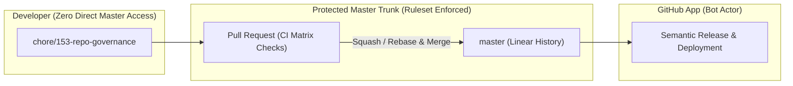
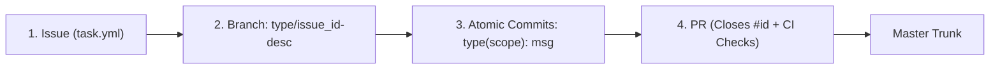

import { Badge, Card, CardGrid, FileTree, LinkCard, Steps, TabItem, Tabs } from '@astrojs/starlight/components';
import FeatureGrid from 'starlight-theme-terminal/components/FeatureGrid.astro';

## 4.1 Historical Repository Audit & The v1.0.0 Baseline

An audit of the `WizardCardGame` repository after *Act II (Distributed Systems)* revealed **496 commits** with significant version-control debt:

<FeatureGrid row={4}>
  <Card title="Development Commits" icon="pencil">
    <Badge text="338 Commits (68.1%)" variant="danger" />
    Non-atomic commits mixing domain model, UI adjustments, and workflow configs (`wip`, `fix tests`).
  </Card>
  <Card title="Merge Commits" icon="random">
    <Badge text="127 Commits (25.6%)" variant="caution" />
    Caused by back-and-forth merges between `origin/master` and long-lived `develop` branches.
  </Card>
  <Card title="Dependency Commits" icon="puzzle">
    <Badge text="23 Commits (4.6%)" variant="note" />
    Ungrouped individual Dependabot commits cluttering the commit timeline.
  </Card>
  <Card title="Premature Releases" icon="rocket">
    <Badge text="8 Commits (1.6%)" variant="tip" />
    Intermediate semantic-release tags (`v0.1.0`-`v0.3.0`) issued before architectural stabilization.
  </Card>
</FeatureGrid>

### The Root Cause: Monolithic Initial Commit (`94d3f77`)
When migrating the single-player engine from *Act I* ([`PPS-25-wizard`](https://github.com/pallax03/PPS-25-wizard)) to `WizardCardGame`, the project started with a single `Initial commit` (**101 files, 12,406 insertions**). It bundled an untested Next.js web client scaffold, transitional Nginx configs (later replaced by Caddy), and unverified CI YAMLs.

### Reconstructing a Bisectable `v1.0.0` Baseline
To ensure tools like **`git bisect run`** can locate regressions automatically, every commit in history must compile and pass tests. We restructured the pre-SPE history into **8 clean, atomic commits**:

<Steps>
  1. `build(repo)`: Multi-platform repository setup and build configs (`sbt`, `npm`).
  2. `feat(domain)`: Core Wizard hexagonal model, rules, and local state.
  3. `feat(ai)`: `tuProlog` theory integration and symbolic bot solver.
  4. `feat(codecs)`: JSON wire codecs for events and game state.
  5. `feat(redis)`: Distributed lobby state, CAS Lua scripts, Pub/Sub, and recovery.
  6. `feat(http)`: Vert.x REST API routes, OpenAPI specs, and WebSockets.
  7. `feat(ui)`: Next.js prototypal web client and multiplayer views.
  8. `build(docker)`: Containerization, Caddy reverse proxy, and baseline CI workflows.
</Steps>

We sealed this baseline with an **Annotated Tag** (`git tag -a v1.0.0 -m "Release v1.0.0: Distributed Wizard Card Game baseline"`). Annotated tags record author, timestamp, and message, ensuring compatibility with `git describe` and automated release tools.

---

## 4.2 Branching Strategy & Ruleset Governance



### Trunk-Based Development with Short-Lived Branches
GitFlow (`master`, `develop`, `releases/*`) proved excessive for a 1-2 person team and directly caused the 127 merge commits in Act II. From `v1.0.0` onward, we use **Trunk-Based Development**:
- `master` is the single permanent trunk, kept continuously releasable.
- Work happens on short-lived branches: `<type>/<issue-id>-<description>` (e.g. `chore/153-repo-governance`, `ci/154-dry-matrix-pipelines`).

### Security & Least Privilege: GitHub Rulesets and Dedicated Bot App
To prevent human error (accidental force pushes, committing directly to `master` when tired), access to `master` is locked down using **GitHub Rulesets**:
1. **Direct Pushes Blocked**: Even repository administrators cannot push directly to `master`.
2. **Mandatory Pull Requests & Status Checks**: All CI matrix jobs must pass before merging.
3. **Dedicated GitHub App (Bot Actor)**: Automated releases and version tagging are delegated to a GitHub App with restricted permissions, separating routine human coding from privileged release workflows.

---

## 4.3 Conventional Commits & Scope Taxonomy

Commits follow the **Conventional Commits** specification:
```text
<type>(<scope>)<!>: <imperative summary in lowercase>
```

- **Type Semantics**: `feat` triggers a `MINOR` release, `fix` triggers a `PATCH` release, and the `!` suffix (or `BREAKING CHANGE` footer) triggers a `MAJOR` release. Non-releasing types (`ci`, `build`, `refactor`, `test`, `docs`, `chore`) skip version bumps.
- **Bounded Scopes**: Scopes are partitioned across our Bounded Contexts and GitHub `area:*` labels, establishing clear architectural boundaries on which files a commit is allowed to touch:

<Tabs>
  <TabItem label="area:engine">
    <Badge text="Game Core Context (Scala 3 / JVM & tuProlog)" variant="tip" />

    **Allowed Types**: `feat`, `fix`, `refactor`, `test`, `chore`

    <FileTree>
      - wizardEngine/
        - src/main/scala/io/github/pallax03/wizard/engine/
          - model/ (pure game rules, entities, state)
          - ports/ (hexagonal inbound/outbound ports)
          - adapters/ (Redis, Vert.x, tuProlog)
    </FileTree>

    - `domain`: Pure game entities, value objects, rules, and turn states.
    - `ai`: `tuProlog` theories and symbolic bot solver.
    - `bot`: Bot orchestration and `GameSituationAnalyzer`.
    - `codecs`: JSON serialization codecs for domain state and events.
    - `lobby`: Lobby lifecycle and match coordination verticles.
    - `redis`: Redis state, CAS Lua scripts, Pub/Sub, and recovery adapters.
    - `http`: Vert.x REST routes, OpenAPI v1 specs, and WebSockets.
  </TabItem>

  <TabItem label="area:dialogue">
    <Badge text="Bot Dialogue Supporting Context (TypeScript & PostgreSQL)" variant="note" />

    **Allowed Types**: `feat`, `fix`, `refactor`, `test`, `chore`

    - `dialogue-db`: PostgreSQL schema (`bot_dialogue`), conditional RPC functions, and deterministic phrase seeds.
    - `dialogue-api`: Phrase selection engine, template interpolation, and HTTP reaction handler.
  </TabItem>

  <TabItem label="area:client">
    <Badge text="Web Client Context (Next.js / TypeScript)" variant="caution" />

    **Allowed Types**: `feat`, `fix`, `refactor`, `test`, `chore`

    <FileTree>
      - application/
        - src/
          - features/ (game board, lobby session, chat hook)
          - ui/ (reusable presentation components)
    </FileTree>

    - `ui`: Web client views, game board renderers, player status cards, and real-time chat hooks.
  </TabItem>

  <TabItem label="area:devops">
    <Badge text="Platform & Automation (CI/CD, Docker, Caddy)" variant="success" />

    **Allowed Types**: `ci`, `build`, `chore`, `fix`

    <FileTree>
      - .github/
        - workflows/ (ci.yml, release.yml)
        - actions/ (composite setup actions)
      - Dockerfile, compose.yml, Caddyfile
    </FileTree>

    - `ci`: GitHub Actions workflows, multi-OS matrices, and composite actions.
    - `docker`: Dockerfiles, Caddy reverse proxy, and container compose stack.
    - `release`: Semantic release configuration and automated tag publishing.
    - `deps`: Automated dependency updates (Renovate configuration).
  </TabItem>

  <TabItem label="area:docs">
    <Badge text="Documentation & Governance (Report & Manifests)" variant="note" />

    **Allowed Types**: `docs`, `chore`

    <FileTree>
      - report/ (Astro Starlight technical report on docs branch)
      - AGENTS.md, AI-DECLARATION.md, README.md
    </FileTree>

    - `docs`: Technical report chapters, architectural decision logs, and governance manifests (`AGENTS.md`, `AI-DECLARATION.md`, `README.md`).
  </TabItem>
</Tabs>

---

## 4.4 Branch Reconciliation: Squash vs. Rebase

Following the principle that *"only what logically belongs together should be committed together"*, branch reconciliation is structured in two phases without arbitrary numerical commit limits:

1. **Local Interactive Cleanup (`git rebase -i origin/master`)**:
   Executed strictly on the developer's unshared short-lived branch before integration (*never rebasing shared history*). Noisy trial checkpoints (`wip`, intermediate test runs) are compacted so that every remaining commit compiles and passes all tests independently.
2. **Pull Request Integration on `master`**:
   - **Squash and Merge**: Collapses the branch into **1 atomic commit** on `master` for single-concern tasks (bug fixes, CI/CD adjustments, documentation updates, or grouped dependency bumps).
   - **Rebase and Merge (or Merge `--no-ff` after Rebase)**: Preserves individual commits when a feature branch is structured as sequential, self-contained architectural steps (e.g., domain model $\rightarrow$ port/adapter $\rightarrow$ integration tests), maintaining fine-grained `git bisect` traceability.

---

## 4.5 Issue-Driven Workflow & Repository Hygiene

Every change starts from a **GitHub Issue**:



1. **Structured Issue Forms (`.github/ISSUE_TEMPLATE/`)**: Rather than unstructured free text, issues use YAML forms requiring a clear objective, architectural boundaries (*what not to touch*), and a **Definition of Done (DoD)** checklist, linking directly to [Section 4.3](#43-conventional-commits--scope-taxonomy) as the Single Source of Truth (DRY).
2. **Traceability without Friction**: Branch names reference the issue (`chore/153-repo-governance`), and PRs link it via `Closes #153`.
3. **Repository Hygiene**:
   - **`.gitattributes`**: Normalizes text files to LF (`* text=auto eol=lf`) while preserving CRLF for Windows scripts (`.bat`, `.cmd`, `.ps1`), preventing cross-OS line-ending diffs in CI.
   - **`.gitignore`**: Excludes build artifacts (`target/`, `.next/`, `dist/`), dependencies (`node_modules/`), and local secrets (`.env*`), while explicitly tracking `.env.example`, `AGENTS.md`, and `AI-DECLARATION.md`.

### 4.5.1 Managing Complex Issues, PR Slicing & AI Governance

To prevent integration hell, scope creep, and broken bisections in Trunk-Based Development, we enforce four operational rules:

1. **Epic Decomposition via Native Sub-Issues**: Macro-features (e.g., `humanize-bot`) are tracked in an Epic Issue decomposed into atomic child issues using **GitHub Native Sub-Issues** and **Issue Dependencies (`blocked by`)**, avoiding external project-management bloat.
2. **"No Piggybacking" Bug Triage**: Bundling unrelated bug fixes into an active feature PR is strictly forbidden. Any spawned sub-task or defect isolated mid-development is linked in the PR description with the engineering rationale:
   - **Blocker**: Pause the feature branch, mark the issue as `blocked by`, fix and test the bug in a dedicated `fix/<id>-<slug>` PR merged to `master`, then rebase.
   - **Non-blocker**: Log a new issue via `bug_report.yml`, link it as a sub-issue or follow-up, and continue the feature without scope expansion.
3. **Single-Concern PRs & Architectural Slicing**: Rather than enforcing rigid line-count thresholds, every commit must be a self-contained, compilable, and testable unit, and every PR must resolve a single issue (`Closes #<id>`). Cross-cutting features are sliced across architectural boundaries (Domain $\rightarrow$ Adapters $\rightarrow$ UI).
4. **Declarative Labeling & AI Agent Guardrails (`AGENTS.md` / `AI-DECLARATION.md`)**:
   - **Zero-Bot Labeling**: Static labels (`bug`, `triage`, `dependencies`) are assigned natively via YAML issue forms and `renovate.json`, while `area:*` labels are selected directly in GitHub's native sidebar without third-party labeler bots.
   - **AI Anti-Over-Engineering & Commit Discipline**: Compliant with [`AI-DECLARATION.md`](https://ai-declaration.md/) and [`AGENTS.md`](https://agents.md/), repository manifests transparently declare GenAI usage levels and instruct coding agents to avoid speculative abstractions, never run monolithic `git add .` mega-commits, and strictly respect bounded scopes.
