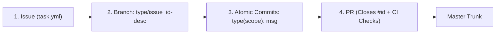

import { Badge, Card, CardGrid, FileTree, LinkCard, Steps, TabItem, Tabs } from '@astrojs/starlight/components';

## 4.1 Historical Repository Audit & The v1.0.0 Baseline

An audit of the `WizardCardGame` repository after *Act II (Distributed Systems)* revealed **496 commits** with significant version-control debt:

<CardGrid>
  <Card title="Development Commits" icon="pencil">
    <Badge text="338 Commits (68.1%)" variant="danger" />
    Non-atomic commits mixing domain model, UI adjustments, and workflow configs (`wip`, `fix tests`).
  </Card>
  <Card title="Merge Commits" icon="random">
    <Badge text="127 Commits (25.6%)" variant="caution" />
    Caused by back-and-forth merges between `origin/master` and long-lived `develop` branches.
  </Card>
  <Card title="Dependency Commits" icon="puzzle">
    <Badge text="23 Commits (4.6%)" variant="note" />
    Ungrouped individual Dependabot commits cluttering the commit timeline.
  </Card>
  <Card title="Premature Releases" icon="rocket">
    <Badge text="8 Commits (1.6%)" variant="tip" />
    Intermediate semantic-release tags (`v0.1.0`-`v0.3.0`) issued before architectural stabilization.
  </Card>
</CardGrid>

### The Root Cause: Monolithic Initial Commit (`94d3f77`)
When migrating the single-player engine from *Act I* ([`PPS-25-wizard`](https://github.com/pallax03/PPS-25-wizard)) to `WizardCardGame`, the project started with a single `Initial commit` (**101 files, 12,406 insertions**). It bundled an untested Next.js web client scaffold, transitional Nginx configs (later replaced by Caddy), and unverified CI YAMLs.

### Reconstructing a Bisectable `v1.0.0` Baseline
To ensure tools like **`git bisect run`** can locate regressions automatically, every commit in history must compile and pass tests. We restructured the pre-SPE history into **8 clean, atomic commits**:

<Steps>
  1. `build(repo)`: Multi-platform repository setup and build configs (`sbt`, `npm`).
  2. `feat(domain)`: Core Wizard hexagonal model, rules, and local state.
  3. `feat(ai)`: `tuProlog` theory integration and symbolic bot solver.
  4. `feat(codecs)`: JSON wire codecs for events and game state.
  5. `feat(redis)`: Distributed lobby state, CAS Lua scripts, Pub/Sub, and recovery.
  6. `feat(http)`: Vert.x REST API routes, OpenAPI specs, and WebSockets.
  7. `feat(ui)`: Next.js prototypal web client and multiplayer views.
  8. `build(docker)`: Containerization, Caddy reverse proxy, and baseline CI workflows.
</Steps>

> We sealed this baseline with an **Annotated Tag** (`git tag -a`).

Annotated tags record author, timestamp, and message, ensuring compatibility with `git describe` and automated release tools.

---

## 4.2 Branching Strategy & Ruleset Governance

### Trunk-Based Development with Short-Lived Branches
GitFlow (`master`, `develop`, `releases/*`) proved excessive for a 1-2 person team and directly caused the 127 merge commits in Act II. From `v1.0.0` onward, we use **Trunk-Based Development**:
- `master` is the single permanent trunk, kept continuously releasable.
- Work happens on short-lived branches: `<type>/<issue-id>-<description>` (e.g. `chore/153-repo-governance`, `ci/154-dry-matrix-pipelines`).

### Security & Least Privilege: GitHub Rulesets and Dedicated Bot App
To prevent human error, access to `master` is locked down using **GitHub Rulesets**:
1. **Direct Pushes Blocked**: Even repository administrators cannot push directly to `master`.
2. **Mandatory Pull Requests & Status Checks**: All CI matrix jobs must pass before merging.
3. **Dedicated GitHub App (Bot Actor)**: Automated releases and version tagging are delegated to a GitHub App with restricted permissions, separating routine human coding from privileged release workflows.
4. **Deferred `CODEOWNERS` Enforcement**: `.github/CODEOWNERS` is defined to prepare for future contributors, indeed *Require review from Code Owners* is **intentionally disabled** in the Ruleset for a solo maintainer (enforcing it would block Renovate automerge unless paired with an auto-approve bot).

### Orphan `docs` Branch Workflow & Trade-Offs
- **Isolation**: The technical report lives on an isolated orphan branch (`docs`) built with Astro Starlight and deployed to GitHub Pages via `.github/workflows/pages.yml`, keeping `master` history and `git bisect` free of documentation-only noise and allowing the report to evolve independently across courses.
- **Pragmatic Contribution Flow**: `area:docs` **Issues** serve as a structured backlog alongside code development, while **Pull Requests are omitted on `docs`** in favor of **direct pushes**.
- **Accepted Trade-Offs**:
  1. Unlike `master`, `docs` does not enforce PR ceremony squash/rebase, so its history will grow less linear over time.
  2. **Zero-Bot Dependency Policy**: `docs` build-time dependencies are locked via `package-lock.json` and updated manually on demand rather than adding a bot for noisy PRs on a static site with no server runtime.

---

## 4.3 Conventional Commits & Scope Taxonomy

Commits follow the **Conventional Commits** specification:
```text
<type>(<scope>)<!>: <imperative summary in lowercase>
```

- **Type Semantics**: `feat` triggers a `MINOR` release, `fix` triggers a `PATCH` release, and the `!` suffix (or `BREAKING CHANGE` footer) triggers a `MAJOR` release.
  > [See SemVer in Conventional Commits.](https://www.conventionalcommits.org/en/v1.0.0/#how-does-this-relate-to-semver)
- **Client-Side Enforcement**: Local Git hooks managed by **Husky** enforce commit quality before push: 
  - `.husky/commit-msg` validates [Conventional Commits](https://www.conventionalcommits.org) via `@commitlint/config-conventional`
  - `.husky/pre-commit` runs `lint-staged` for ESLint and `scalafmt` 
    > [PR #215](https://github.com/pallax03/WizardCardGame/pull/215): explicitly bypassed in CI releases via `HUSKY=0` in `release.yml`.
- **Bounded Scopes**: Scopes are partitioned across our Bounded Contexts and GitHub `area:*` labels, establishing clear architectural boundaries on which files a commit is allowed to touch:

<Tabs>
  <TabItem label="area:engine">
    <Badge text="Game Core Context (Scala 3 / JVM & tuProlog)" variant="tip" />

    **Allowed Types**: `feat`, `fix`, `refactor`, `test`, `chore`

    <FileTree>
      - wizardEngine/
        - src/main/scala/io/github/pallax03/wizard/engine/
          - model/ (pure game rules, entities, state)
          - lobby/ (lobby domain)
          - ports/ (hexagonal inbound/outbound ports)
          - adapters/ (Redis, Vert.x, tuProlog)
          - codecs/ (JSON Domain Schemas)
          - application/
            - bot/ (Bot Orchestrator)
            - timer/ (Timers Orchestrator)
            - web/
              - http/ (REST routes & OpenAPI)
              - ws/ (WebSocket)
    </FileTree>
  </TabItem>

  <TabItem label="area:dialogue">
    <Badge text="Bot Dialogue Supporting Context (TypeScript & PostgreSQL)" variant="note" />

    **Allowed Types**: `feat`, `fix`, `refactor`, `test`, `chore`

    <FileTree>
      - packages/
        - protocol (Published Language TypeScript schemas, from OpenAPI)
        - bot-dialogue/
          - dialogue-core (domain + business logic)
          - dialogue-worker (ACL + Outbound in Redis Pub / Sub)
          - dialogue-db (Read-only PostgreSQL schema)
    </FileTree>
  </TabItem>

  <TabItem label="area:client">
    <Badge text="Web Client Context" variant="caution" />

    **Allowed Types**: `feat`, `fix`, `refactor`, `test`, `chore`

    <FileTree>
      - application/
        - src/
          - app/ (Next.js App Router pages)
          - features/ (game board, lobby session, chat hook)
          - lib/ (API clients & shared utilities)
          - ui/ (reusable components from **Shadcn**)
    </FileTree>
  </TabItem>

  <TabItem label="area:devops">
    <Badge text="Platform & Automation (CI/CD, Docker, Caddy)" variant="success" />

    **Allowed Types**: `ci`, `build`, `chore`, `fix`

    <FileTree>
      - .github/
        - workflows/ (ci.yml, release.yml, deploy.yml)
        - actions/ (composite setup actions)
      - wizardEngine/Dockerfile, application/Dockerfile
      - compose.yml, Caddyfile
    </FileTree>
  </TabItem>

  <TabItem label="area:docs">
    <Badge text="Documentation & Governance (Report & Manifests)" variant="note" />

    **Allowed Types**: `docs`, `chore`, `ci`

    <FileTree>
      - report/ (Astro Starlight technical report on `docs` branch)
      - AGENTS.md
      - AI-DECLARATION.md
      - README.md
    </FileTree>
  </TabItem>
</Tabs>

---

## 4.4 Branch Reconciliation: Squash vs. Rebase

Following the principle that *"only what logically belongs together should be committed together"*, branch reconciliation is structured in two phases without arbitrary numerical commit limits:

1. **Local Interactive Cleanup (`git rebase -i origin/master`)**:
   Executed strictly on the developer's unshared short-lived branch before integration (*never rebasing shared history*).
2. **Pull Request Integration on `master`**:
   - **Squash and Merge**: Collapses the branch into **1 atomic commit** on `master` for single-concern tasks.
   - **Rebase and Merge**: Preserves individual commits when a feature branch is structured as sequential, self-contained architectural steps (e.g., domain model $\rightarrow$ port/adapter $\rightarrow$ integration tests), maintaining fine-grained `git bisect` traceability.

---

## 4.5 Issue-Driven Workflow & Governance

Every change on `master` starts from a **GitHub Issue**:



<Tabs>
  <TabItem label="Slicing & Piggybacking">
    | Rule | Policy |
    | :--- | :--- |
    | **Decomposition** | Epics split into atomic child tasks via GitHub Native **Sub-Issues** and `blocked by` dependencies. |
    | **Architectural Slicing** | **1 Issue = 1 PR** (`Closes #<id>`), sliced across layers (Domain -> Adapters -> UI) rather than rigid LOC caps. |
    | **DRY DoD** | Task-specific DoD lives in `task.yml`; global QA DoD lives once in the PR template and `AGENTS.md`. |

    :::caution[No Piggybacking]
    Unrelated fixes are forbidden inside an active feature PR:
    - <Badge text="Blocker" variant="danger" /> Pause feature, link `blocked by`, merge a dedicated `fix/<id>` PR, then rebase.
    - <Badge text="Non-Blocker" variant="note" /> Open `bug_report.yml` as a follow-up and keep the feature scope untouched.
    :::
  </TabItem>

  <TabItem label="Taxonomy & Hygiene">
    | Concern | Implementation |
    | :--- | :--- |
    | **Issue Types** | Native GitHub types (`Bug`, `Task`, `Feature`). |
    | **Labels (Zero Bots)** | Static labels (`triage`, `dependencies`, `released`) assigned natively; `area:*` picked in the sidebar. |

    :::danger[No Binary Bloat]
    Binary or non-diffable files must never be committed, keeping the repository lightweight (avoiding Git LFS) with minimal static assets:
    - **`.gitignore`**: Excludes binaries, build artifacts, and local secrets; explicitly tracks `.env.example`, `AGENTS.md`, and `AI-DECLARATION.md`.
    - **`.gitattributes`**: Enforces `LF` for text files while preserving `CRLF` for Windows scripts.
    :::
  </TabItem>

  <TabItem label="AI Guardrails">
    Repository manifests ([`AGENTS.md`](https://agents.md/) and [`AI-DECLARATION.md`](https://ai-declaration.md/)) enforce transparent and bounded GenAI usage:

    - **Disclosure**: GenAI assistance levels are declared explicitly in `AI-DECLARATION.md`.
    - **Scope Discipline**: Coding agents must respect the bounded scopes in [Section 4.3](#43-conventional-commits--scope-taxonomy) and avoid speculative abstractions.
    - **Atomic Git**: Monolithic commits are prohibited; agents follow the same issue-driven flow as humans.
  </TabItem>
</Tabs>

<LinkCard
  title="Project Kanban Board"
  description="Live GitHub Issues view tracking milestones, sub-issues, and dependencies."
  href="https://github.com/pallax03/WizardCardGame/issues/views/MDQ6VmlldzMyNTA0"
/>